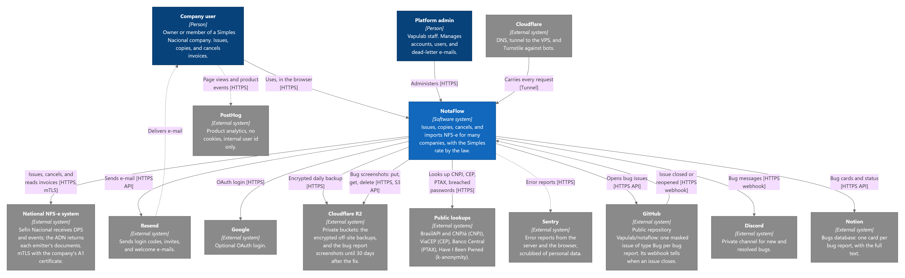
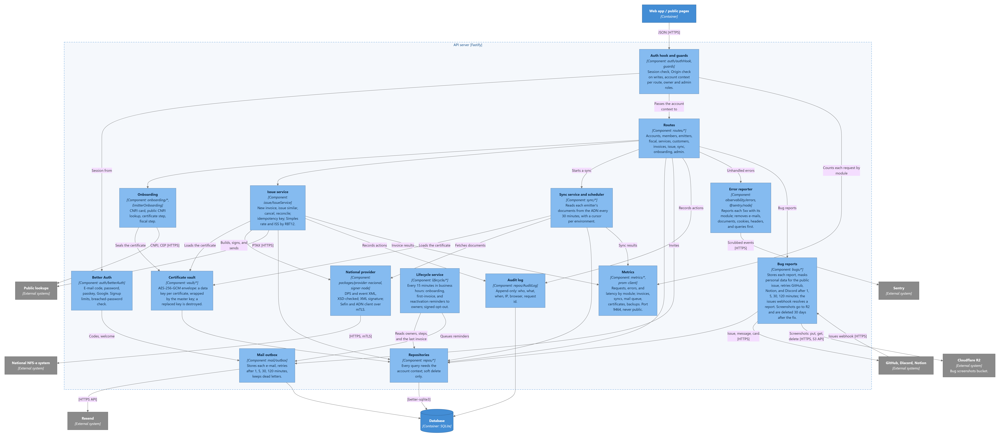

# Architecture Overview

NotaFlow is one app container behind a Cloudflare tunnel. A Fastify server holds the domain, the certificate vault, the jobs, and the mail outbox, and it serves the React UI and the public pages. Each invoice system is a provider package behind a port. The full design is in the [RFC](../RFCS/2026/10/RFC_NFSE_EMITTER.md).

A monitoring stack on the same VPS collects the app's metrics by module, the logs of every container, and alerts to Discord. Sentry receives the errors of the server and the browser, scrubbed of personal data. See the [Monitoring RFC](../RFCS/2026/10/RFC_MONITORING.md) and the [Monitoring tutorial](../../TUTORIALS/MONITORING.md).

A bug that a customer reports in the app goes to a masked GitHub issue, a Discord message, and a Notion card. The GitHub issues webhook resolves the report when the issue closes. Its screenshots go to a private Cloudflare R2 bucket, never to those three systems, and the server deletes them 30 days after the fix. See the [Bug Reports RFC](../RFCS/2026/10/RFC_BUG_REPORTS.md).

The C4 diagrams below go from the outside in. Their sources and how to change them are in [diagrams/](diagrams/README.md).

## System Context

Who uses NotaFlow, and which external systems it talks to.

## Containers

The parts that run: the web app and the public pages in the browser, the tunnel, the API server, the SQLite database, the CNPJ card parser, the backup timer, and the monitoring stack.

## Server Components

Inside the API server: every request passes the auth hook, which gives the routes an account context; the services use the vault, the national provider, and the repositories. Each request is counted by module in the metrics, and each 5xx goes to the error reporter. The lifecycle service sends the onboarding, first-invoice, and reactivation reminders through the mail outbox. The bug reports component sends each report to GitHub, Notion, and Discord with retries, and keeps its screenshots in R2.

## Deployment

Production on the Hostinger VPS: the app's Docker Compose service behind the shared Cloudflare tunnel, deployed by GitHub Actions on every merge to `production`. The monitoring stack is a second Compose project, installed by hand; Grafana is at `grafana.vapulab.com` behind Cloudflare Access, and Healthchecks.io alerts when the VPS stops sending its Watchdog. The day-to-day commands are in [Deploy on the VM](../../TUTORIALS/DEPLOY_ON_VM.md).

## Packages

| Package | Responsibility |
| --- | --- |
| `packages/core` | Domain types and ports. No I/O. |
| `packages/test-kit` | Test-only helpers, such as self-signed e-CNPJ certificates. |
| `packages/signer-node` | Loads a `.pfx` and signs XML (`Signer` port). |
| `packages/provider-nacional` | DPS and event XML, and the Sefin and ADN client. |
| `packages/fake-nacional` | In-memory fake of the Sefin and the ADN for development and tests. Never in production. |
| `services/signer-py` | Python `Signer`, kept as plan B. |
| `apps/server` | API, persistence, vault, authorization (Stage 1a-2); sync jobs (Stage 1a-3). |
| `apps/web` | React UI, built with Vite and served by the server (Stage 1a-3). |

## Ports

**`Signer`** signs one element of an XML document by its `Id`, and places the `Signature` right after that element. It has two profiles: `rsa-sha1-c14n` and `rsa-sha256-exc-c14n`. The Stage 0 spike decides which implementation and profile production uses.

**`InvoiceProvider`** is what an invoice system implements. The read side (Stage 1a) checks the connection, fetches documents since a cursor (`fetchSince`), and gets one invoice by access key. `NacionalProvider` is the national implementation.

**`InvoiceIssuer`** issues a new invoice from a source, finds an invoice by DPS id, and cancels. The source is a stored NFS-e to copy (`stored`) or a template built from the emitter, the service, and the customer (`built`, from `buildTemplate`). `NacionalIssuer` is the national implementation. See [Invoice Lifecycle](INVOICE_LIFECYCLE.md).

**`CertificateStore`** stores and loads tenant certificates. Each certificate is encrypted with its own data key, and `NFSE_MASTER_KEY` wraps that key. See [Certificate Vault](CERTIFICATE_VAULT.md); accounts and roles are in [Tenancy](TENANCY.md), and signup in [Onboarding](ONBOARDING.md).

## Rules that hold across packages

- `core` does not import XML, HTTP, or database code.
- Every XML builder validates against the official XSD in a test.
- mTLS uses the PEM key and certificate from `loadCertificate`, never the raw `.pfx`.
- The ADN sync (cursor per environment, retries, document rules) is in [ADN Sync](SYNC.md).
