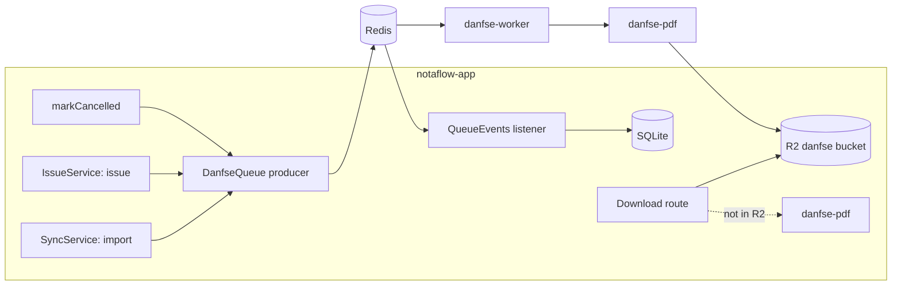

# RFC: DANFSe PDF Generation

**Status:** Approved in design (2026-10-26). Plan A (renderer) is merged. Plan B (queue, worker, R2, PDF state) is implemented on `feat/danfse-queue`. The link page, share options, and automatic e-mail are not built yet.
**Date:** 2026-10-26
**Owner:** Lincoln Santos (Vapulab)

**References:**

- NT SE/CGNFS-e nº 008 v1.02 (DANFSe), 2026-07-14: <https://www.gov.br/nfse/pt-br/biblioteca/documentacao-tecnica/rtc/nt-008-se-cgnfse-danfse-20260714-v1-02.pdf>
- NFS-e logo for the DANFSe header: <https://www.gov.br/nfse/pt-br/biblioteca/documentacao-tecnica/logos-da-nfs-e>
- [Bug Reports RFC](RFC_BUG_REPORTS.md) (the R2 client and the private bucket pattern)
- [Monitoring RFC](RFC_MONITORING.md) (metrics, Grafana alerts to Discord)
- [Data](../../../CONVENTIONS/DATA.md) and [Secrets](../../../CONVENTIONS/SECRETS.md)
- BullMQ: <https://docs.bullmq.io/>

## Table of Contents

1. [Overview](#overview)
2. [Problem Statement](#problem-statement)
3. [Goals, Non-Goals, and Anti-Goals](#goals-non-goals-and-anti-goals)
4. [Decisions](#decisions)
5. [Design](#design)
6. [The DANFSe Layout](#the-danfse-layout)
7. [Queue, Retry, and DLQ](#queue-retry-and-dlq)
8. [Download and Public Link](#download-and-public-link)
9. [Screens](#screens)
10. [Data Model](#data-model)
11. [Configuration and Deployment](#configuration-and-deployment)
12. [Metrics and Alerts](#metrics-and-alerts)
13. [Backfill](#backfill)
14. [Testing](#testing)
15. [Roadmap](#roadmap)
16. [Left to the Builder](#left-to-the-builder)

---

## Overview

NotaFlow generates the DANFSe PDF of each invoice from the invoice XML that it already stores. It does not call the ADN. A new worker container takes jobs from a Redis queue (BullMQ), draws the PDF in code to the NT 008 layout, and stores it in a new private R2 bucket. The app serves the PDF from R2, and draws it on demand when R2 does not have it yet.

Each invoice also gets a public link, `/n/<token>`. The page behind the link shows a short summary of the invoice, a download button, and a NotaFlow call to action. This page is the organic marketing surface. The PDF itself carries no NotaFlow brand, because NT 008 does not allow it.

---

## Problem Statement

- **The download depends on a suspended API.** `GET /api/accounts/:accountId/invoices/:invoiceId/danfse` asks the ADN for the PDF on each click (`apps/server/src/routes/invoices.ts`). NT 008, item 1, suspends the ADN DANFSe API from 2026-08-03 ("será sobrestada (suspensa) na data de 03 de agosto de 2026"). Since then, each issuing system must generate its own DANFSe. Customers see `danfse_unavailable` errors.
- **We already have all the data.** The `invoices.xml_gzip` column holds the XML of each issued or synced invoice, and `invoice_events.xml_gzip` holds the event XML (for example, a cancellation).
- **No marketing reach.** Each invoice goes from our customer to their own customer, but nothing in that path shows NotaFlow.

---

## Goals, Non-Goals, and Anti-Goals

**Goals**

1. Every issued, synced, or cancelled invoice has a DANFSe PDF that follows NT 008.
2. The download never depends on the ADN.
3. The PDF work is asynchronous, with retry and a DLQ. The worker is a separate container that can move to a cloud with no code change.
4. A customer can share a public link to the PDF with their own customer. The link page shows NotaFlow.
5. The screens show the PDF state ("Gerando PDF…") without blocking the screen.
6. A member can copy the link or share it (native share, WhatsApp, their own e-mail app, or an e-mail that NotaFlow sends).
7. Invoices already in the database get their PDF through the migration that marks them pending.

**Non-goals**

- The NT 008 layout for the "novos fatos geradores" of IBS/CBS (NT 008, item 1 says a separate NT will define it).
- The optional "Canhoto" block (NT 008, item 2.4.5, note 11).

**Anti-goals** (the work fails if any of these is true, even if it runs)

- A DANFSe that does not follow NT 008: extra content in the PDF, a second page, or wrong margins. The risk falls on our customer.
- A customer sees an error on "Baixar PDF" because the queue or the worker is down.
- The worker reads the SQLite file or depends on anything that exists only on the VM.
- A public link that a person can guess, or that exposes the CPF of a natural-person customer on the web page.

---

## Decisions

Lincoln made these decisions in the design conversation:

| Decision | Choice |
| --- | --- |
| Generation | From the stored XML, not from the ADN |
| Queue | Redis + BullMQ, with retry and DLQ |
| Worker | A separate container |
| Storage | A new private R2 bucket |
| Download | Serve from R2; draw on demand when the PDF is not there |
| Public link | Yes, so the customer can pass the PDF to their own customer |
| NotaFlow brand | On the public link page (call to action with UTM), not in the PDF, because NT 008 does not allow extra content |
| Screens | "Gerando PDF…" with a spinner; the screen stays free |
| Sharing | "Copiar link" stays, and a "Compartilhar" button adds native share, WhatsApp, `mailto:`, and an e-mail that NotaFlow sends |
| Automatic e-mail | NotaFlow e-mails the link to the customer's customer after each issue, from day one (a per-emitter setting) |
| Other calls approved on 2026-10-26 | The link works on a suspended account; the token is stored in plain text; XML stays at most 30 days in Redis; the rate limits below |
| Old invoices | Migration 0022 marks them pending; the sweep enqueues them |
| Future | The app may leave the VM for a cloud |

These are design calls by the author of this RFC, open to review:

| Decision | Choice | Why |
| --- | --- | --- |
| PDF engine | Draw in code (`pdf-lib` or `pdfkit`), no Chromium | The DANFSe is a fixed form. Chromium costs 300 to 500 MB per browser. |
| Job payload | Carries the XML (gzip, base64), not only the id | The worker needs no database access. |
| PDF state | The app marks rows pending in the same transaction as the change, a sweep enqueues them, and the app listens to BullMQ `QueueEvents` to write `invoices.pdf_status` | The worker stays stateless, and a Redis outage loses no work. |
| Cancellation | A third trigger; it draws the PDF again with the "CANCELADA" watermark | NT 008, item 2.5.1 makes the watermark mandatory. This was "future" in the conversation; the NT moved it into scope. |
| Shared renderer | A new package `packages/danfse-pdf` | The worker and the on-demand path in the app use the same code. |
| Link token | 32 random bytes, base64url, stored as plain text | The screens must give the same URL again ("Copiar link", "Compartilhar"). A hash cannot give it back, and a new link per copy breaks links already sent. A leaked database already leaks the invoice data itself. |
| Substitution | Event `105102` (cancellation by substitution) draws "SUBSTITUÍDA"; other cancellations draw "CANCELADA" | Sync already imports substitutions and stores them as `cancelled`. NT 008, item 2.5.2 asks for "SUBSTITUÍDA". |
| Link after a state change | Cancelled or substituted: the page works, shows the PDF with the watermark and a "Nota cancelada" or "Nota substituída" notice. Suspended account: the link keeps working. Soft-deleted invoice, emitter, or account: 404. Produção restrita: allowed (the PDF says "SEM VALIDADE JURÍDICA") | The customer's customer must always reach a valid record; our billing state is not their problem. |
| XML in Redis | Failed jobs stay 30 days (`removeOnFail: { age: 30 days }`); after that the on-demand path still serves the PDF | The payload holds the customer's CPF and address. No personal data stays in Redis without a limit. |
| Link page content | Emitter name, invoice number, date, net amount, the download button, and the call to action. No customer document | A natural-person customer has a CPF. |
| ADN call | Remove it from the download route | The API is suspended. |

---

## Design

1. **Mark pending.** Every change that needs a new PDF sets `invoices.pdf_status = 'pending'` in the same transaction as the change:
   - Sync stores a new invoice with XML, or an existing invoice changes its XML or its status.
   - `markIssued` stores the XML of an invoice that the app issued.
   - Any change of an invoice to `cancelled`: `markCancelled`, `recordEvent`, the cancelled flag on the sync insert, and `promote`. The job draws the PDF again with the watermark.

   `pdf_pending_since` records when the row became pending. A re-enqueue keeps it.
2. **Sweep (outbox).** The app has no "enqueue after commit" step. A dispatcher in the app (`apps/server/src/danfse/DanfseDispatcher.ts`) runs every 10 s. It reads at most 100 `pending` rows and adds one job per row. A Redis outage cannot lose work: the row stays `pending` and the next sweep retries. When a job with the same id is in the failed set, the queue removes it and adds the fresh one. A waiting, active, or delayed job with the same id stays as it is.
3. **Render.** The worker unzips the XML, calls `renderDanfse(xml, { status, environment })` from `packages/danfse-pdf`, and puts the result in R2 at `danfse/<accessKey>.pdf`. A new render of the same invoice writes over the old object.
4. **Record.** The app's `QueueEvents` listener gets `completed` or `failed` (final) and writes `pdf_status = 'ready'` or `'failed'`, with `pdf_rendered_at`.
5. **Serve.** See [Download and Public Link](#download-and-public-link).

The worker is the same image as the app with another command (`node --import tsx apps/danfse-worker/src/main.ts`).

---

## The DANFSe Layout

`packages/danfse-pdf` follows NT 008 v1.02. These rules are the ones a reviewer checks first:

- **One page, A4 portrait** (items 2.2, 2.2.1).
- **Margins** from 0.15 cm to 0.20 cm on each side (item 2.2.2). There is no free area.
- **Lines** of 0.5 pt between blocks, and a 1 pt page border. Light gray (5%) fill on the header, the block titles, "Emitente da NFS-e", and "Valor Líquido da NFS-e + IBS/CBS" (item 2.2.3).
- **The Anexo I model** sets the place of each field (item 2.2.4). Item 2.4.5 gives the coordinates and the minimum font sizes.
- **Only data from the XML.** "Não poderão ser impressas informações que não constem do arquivo da NFS-e" (item 2.1). This rule is why the NotaFlow brand stays out of the PDF.
- **Header:** the NFS-e logo on the left, "DANFSe v2.0" and "Documento Auxiliar da NFS-e" in the center, the municipality name on the right (item 2.4.3).
- **QR code** of at least 1.52 cm x 1.52 cm, to the right of the identification fields, with the text "A autenticidade desta NFS-e pode ser verificada pela leitura deste código QR ou pela consulta da chave de acesso…" below it.
- **Access key** in one block of 50 digits (item 2.1.1).
- **Empty fields** show a dash (-) (item 2.4.5, note 12). Empty blocks use the fixed texts of notes 2, 3, and 4.
- **Informações Complementares** must contain the "Totais Aproximados dos Tributos cfe. Lei nº 12.741/2012" line (note 10).
- **Watermark** "CANCELADA" or "SUBSTITUÍDA", diagonal, Arial, at least 50 pt, gray K35 (items 2.5.1, 2.5.2).
- **Test environment:** when `tpAmb = 2`, the header shows "NFS-e SEM VALIDADE JURÍDICA" below the title (item 2).

The PDF document metadata (`Producer`, `Creator`) says "NotaFlow". This metadata is not printed content.

---

## Queue, Retry, and DLQ

| Item | Value |
| --- | --- |
| Queue name | `danfse` |
| Job id | `<invoiceId>:<mark>`, where mark is `none`, `cancelada`, or `substituida`, so a repeated trigger does not create a second job |
| Payload | `{ invoiceId, accessKey, mark, xmlGzipBase64 }`. The app computes `mark` from the invoice status and its events, not from `invoices.status` alone. BullMQ does not allow `:` in a custom id, so the queue adapter maps it to `_` inside Redis; the port keeps `<invoiceId>:<mark>` |
| Attempts | 5, exponential backoff from 30 s |
| Completed jobs | Removed at once (`removeOnComplete: true`) |
| DLQ | A job that fails 5 times stays in the BullMQ failed set for 30 days. This set is the DLQ. The admin "Gerar de novo" button only moves the row back to `pending`. The next sweep (within 10 s) adds the job again with the current XML. |
| Worker concurrency | 2 (author's call; the VM has 4 vCPU) |

A platform admin sees the DLQ on the section "PDFs não gerados" of `/admin`: the invoice, the last error, and a "Gerar de novo" button.

The on-demand path keeps the customer safe when a job is in the DLQ: the download still works.

---

## Download and Public Link

**Download (logged in).** The existing route `GET /api/accounts/:accountId/invoices/:invoiceId/danfse` changes:

1. If `pdf_status = 'ready'`, stream the object from R2.
2. Otherwise, draw the PDF in the app with `packages/danfse-pdf`, send it, and enqueue a job so that R2 gets it.
3. The route no longer calls the ADN.

**Public link.**

- `POST /api/accounts/:accountId/invoices/:invoiceId/link` creates a link, or returns the active one. Only a member of the account can call it.
- `GET /n/<token>` shows the link page: the emitter name, the invoice number, the issue date, the net amount, a "Baixar PDF" button, and the NotaFlow call to action with a QR code. The call to action points to the landing with `utm_source=danfse_link&utm_medium=referral`. The page has `noindex`.
- `GET /n/<token>/pdf` serves the PDF, with the same R2-or-draw rule as the download.
- A member can revoke a link. A revoked link answers 404.
- The page sends a PostHog event per view, so the marketing reach is measurable.
- Rate limit per IP on `/n/*` (author's call: 60 per minute).

---

## Screens

The invoice list and the invoice detail page show the PDF state on the PDF button:

| `pdf_status` | Button |
| --- | --- |
| `pending` | A small spinner and "Gerando PDF…". The button still works (on-demand path). |
| `ready` | "PDF" downloads from R2. "Copiar link" copies the public link. "Compartilhar" opens the share options. |
| `failed` | "PDF" still works (on-demand path). The customer sees no error. |

The screen asks the server for the state every 3 s, and only while a visible row is `pending`. Nothing blocks the screen. The screens use the Malphas UI components that the app already uses.

**Copiar link** and **Compartilhar** do not need the PDF in R2: they only need the link. They show on every invoice with XML, on the list row and on the detail page. The first use creates the link; later uses give the same link.

**Compartilhar** opens:

| Option | Behavior |
| --- | --- |
| Native share (phones, and browsers with the Web Share API) | `navigator.share` with a ready text: "Segue a NFS-e nº <number> de <emitter>: <link>" |
| WhatsApp | `https://wa.me/?text=<ready text>` |
| E-mail pelo seu app | `mailto:` with the subject and the body filled in |
| Enviar por e-mail (NotaFlow) | A small dialog with the address (prefilled with the customer e-mail from the XML when it exists). The server sends the e-mail through the existing mail outbox: the link, the invoice summary, and the NotaFlow footer with the UTM. Reply-To is the account e-mail. |

Each share sends a PostHog event with the channel. The NotaFlow e-mail has a rate limit per account (author's call: 50 per hour) and a new `MailKind`.

**Automatic e-mail after issue.** Each emitter has a setting "Enviar a nota por e-mail ao tomador após emitir". When it is on, the server sends the same NotaFlow e-mail right after an issue succeeds. Rules (author's calls):

- It applies only to invoices that the app issues (`origin = 'app'`). Sync and the migration never send e-mail, so an import never mails old customers.
- The address comes from the customer e-mail in the XML. With no address, the server skips the e-mail, and the detail page shows "Tomador sem e-mail na nota".
- The e-mail carries the link, not the PDF as an attachment. The link page is the marketing surface, and the link works before the PDF is in R2.
- The setting is off for existing emitters and on for new emitters. The issue form shows the state next to the "Emitir" button ("O tomador vai receber por e-mail"), with a link to change it. The account owner turns it on knowingly; NotaFlow never mails a third party without that choice.
- The detail page shows when the e-mail went out, from the mail outbox row.

---

## Data Model

New columns on `invoices`:

| Column | Type | Note |
| --- | --- | --- |
| `pdf_status` | `'pending' \| 'ready' \| 'failed'`, null | Null for an invoice with no XML (rejected, pending issue) |
| `pdf_rendered_at` | timestamp, null | When the current R2 object was written |
| `pdf_pending_since` | timestamp, null | When the row became pending; kept across re-enqueues. The metric `danfse_pending_oldest_seconds` reads its minimum |

Migration 0022 adds the columns and sets `pdf_status = 'pending'` on every invoice that has XML. This is the backfill (see [Backfill](#backfill)).

New table `invoice_links` (not built yet):

| Column | Type | Note |
| --- | --- | --- |
| `id` | id | |
| `invoice_id` | references `invoices.id` | |
| `token` | text, unique | The random token, in plain text (see [Decisions](#decisions)) |
| `views` | integer | |
| `created_by`, `created_at`, `updated_at`, `updated_by` | | As the other tables |
| removal columns | | Revoke is a soft delete, as [Data](../../../CONVENTIONS/DATA.md) requires |

Every query goes through a repository that takes the account context. The `/n/<token>` lookup is the one read without an account context; it must use a dedicated repository method that returns only the link page fields.

---

## Configuration and Deployment

New containers in `deploy/compose.yaml`:

- `redis`: `redis:7-alpine`, `appendonly yes`, `maxmemory 256mb`, `maxmemory-policy noeviction`, a named volume `redis`, a read-only root, a `redis-cli ping` health check, no published port. It sits only on the internal network `danfse`, so nothing outside the stack reaches it. The VM has no swap, so the memory limit is required.
- `danfse-worker`: the same image as the app (`${IMAGE}`) with another command. It has the `.env` file and no database volume. It waits for a healthy Redis (`depends_on` with `service_healthy`). It sits on `danfse` and on the Compose default network, which is not internal and gives it egress to R2. It does not join `northub` or `monitoring`.

The `app` keeps `northub` and `monitoring` and joins `danfse`. It does not depend on Redis: without it, the queue is off and downloads draw on demand.

New environment variables. Before adding a name, grep the root `.env` for collisions (it holds other projects' variables).

| Name | Used by |
| --- | --- |
| `REDIS_URL` (`redis://redis:6379`) | app, worker |
| `R2_DANFSE_ACCESS_KEY_ID`, `R2_DANFSE_SECRET_ACCESS_KEY`, `R2_DANFSE_BUCKET` | app, worker (with the existing `R2_ACCOUNT_ID`) |

The four DANFSe values go together. With `REDIS_URL` unset, the queue is off: no sweep, and the download draws on demand (dev and tests). `R2_ACCOUNT_ID` alone does not count as a partial bug-report R2 setup, because both features share it.

The R2 client moved from `apps/server/src/bugs/r2.ts` to the package `packages/r2`, so the worker can use it.

This change adds a queue, a worker, and a container. It updates the C4 diagrams in the same PR: `c4-2-containers` and `c4-4-deployment` (`.mmd` and PNG). The manual steps are in the [DANFSe Queue tutorial](../../../../TUTORIALS/DANFSE_QUEUE.md).

Estimated cost on the current VM (4 vCPU, 16 GB, 1.5 GB in use on 2026-10-26): Redis 10 to 30 MB, worker 100 to 150 MB, about 50 to 150 ms of CPU per PDF.

---

## Metrics and Alerts

| Metric | Type |
| --- | --- |
| `danfse_jobs_total{result="completed\|failed"}` | counter |
| `danfse_dlq_size` | gauge |
| `danfse_render_seconds` | histogram |
| `danfse_on_demand_total` | counter (downloads that had to draw on demand) |
| `danfse_link_views_total` | counter (with the link page, not built yet) |
| `danfse_workers` | gauge (workers connected to the queue) |
| `danfse_pending_oldest_seconds` | gauge (age of the oldest pending row) |

Job metrics count jobs, not rows. The queue gauges refresh lazily on a scrape, at most once per 30 s, so a value can be one scrape plus 30 s old.

Alerts to Discord: `DanfseDeadLetters` (`danfse_dlq_size > 0`), `DanfseWorkerDown` (no worker connected, or Redis down), and `DanfsePendingStale` (the oldest pending PDF waits too long). The rules are in `deploy/monitoring/prometheus/rules.yml`.

---

## Backfill

There is no backfill script. Migration 0022 marks every invoice that has XML as `pending`, and the sweep (100 rows every 10 s) enqueues them after the deploy. The job id prevents duplicates, and the sweep is safe to repeat. It works the same on the VM and in a cloud. No manual step is needed.

---

## Testing

- `packages/danfse-pdf`: render synthetic XML from `@notaflow/test-kit` (issued, cancelled, test environment, missing customer, ISSQN not applicable). Check one page, A4 size, the 50-digit key, the watermark text, and the "SEM VALIDADE JURÍDICA" text with `unpdf`. Keep a few golden PDFs for a visual check by a person.
- Worker: a test with a real Redis (testcontainers or a local Redis) and a fake R2.
- App: the download route (R2 hit, R2 miss, Redis down), the `QueueEvents` listener, the link routes (create, view, revoke, guess a wrong token).
- Web: the three button states and the stop of polling.

---

## Roadmap

- The DANFSe layout for the IBS/CBS "novos fatos geradores", when the specific NT comes out.
- Issue a substitution from the app. The "SUBSTITUÍDA" watermark ships now for substitutions that sync imports.

---

## Left to the Builder

- `pdf-lib` or `pdfkit`, the QR code library, and the font files (an Arial-metric font with a free license, for example Liberation Sans or Arimo).
- The exact package and app names (`packages/danfse-pdf`, `apps/danfse-worker`).
- The look of the link page, inside the Malphas theme.
- The admin DLQ page layout.
